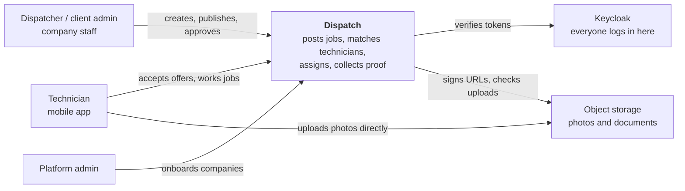
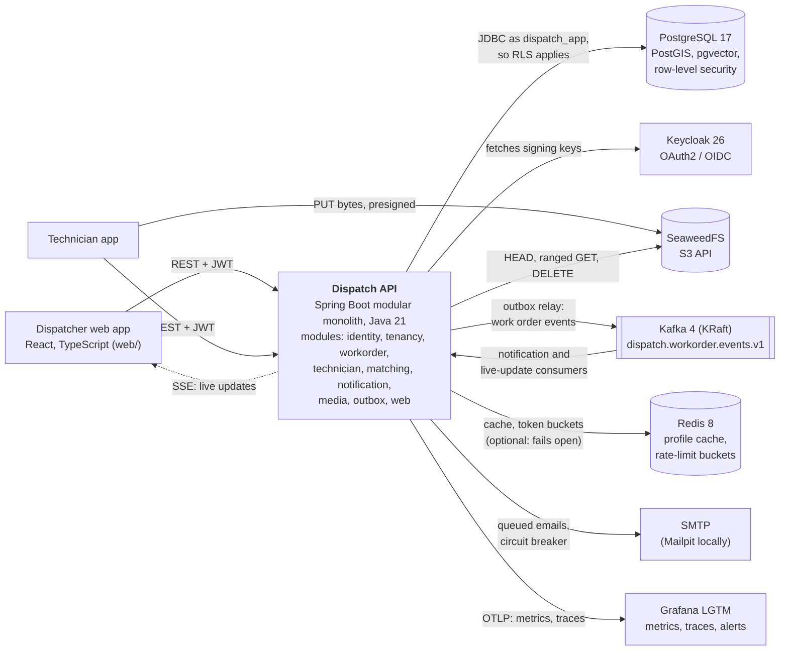
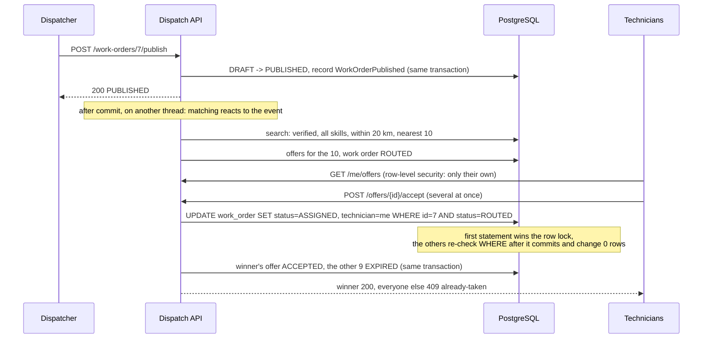
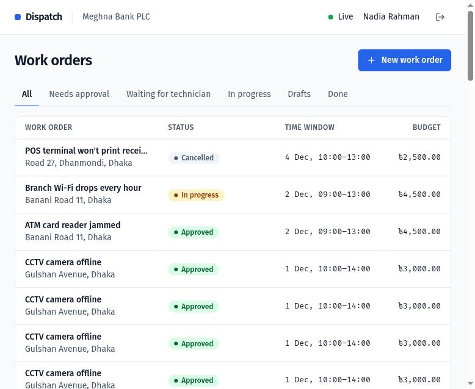
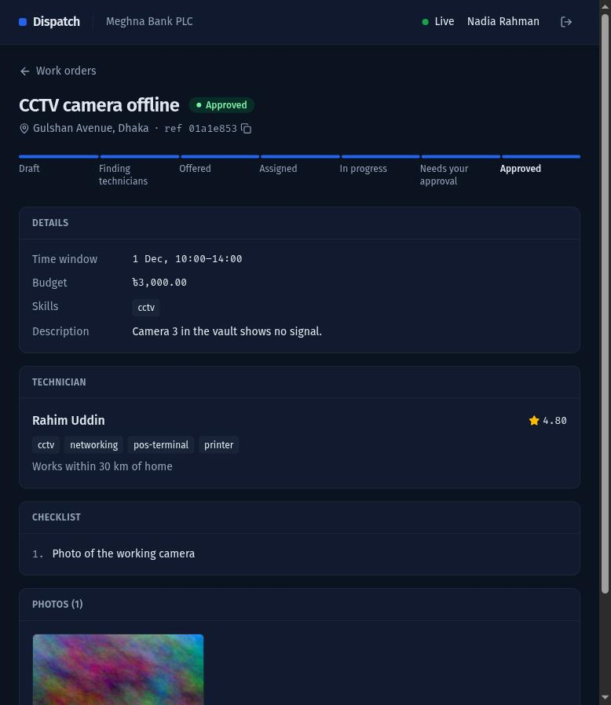
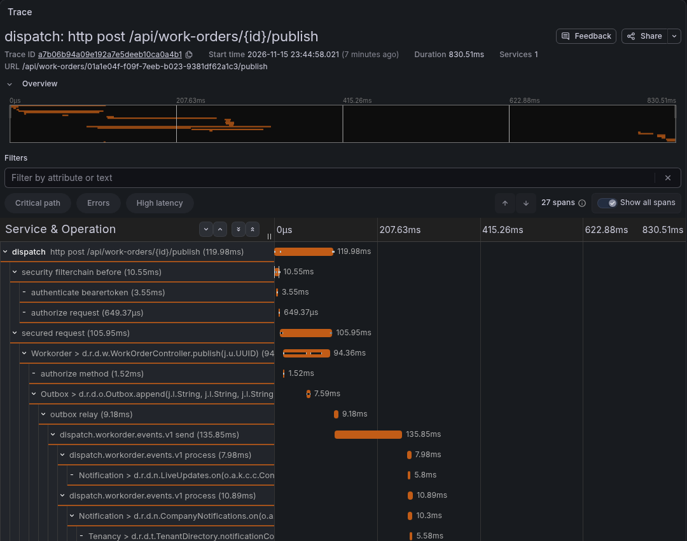
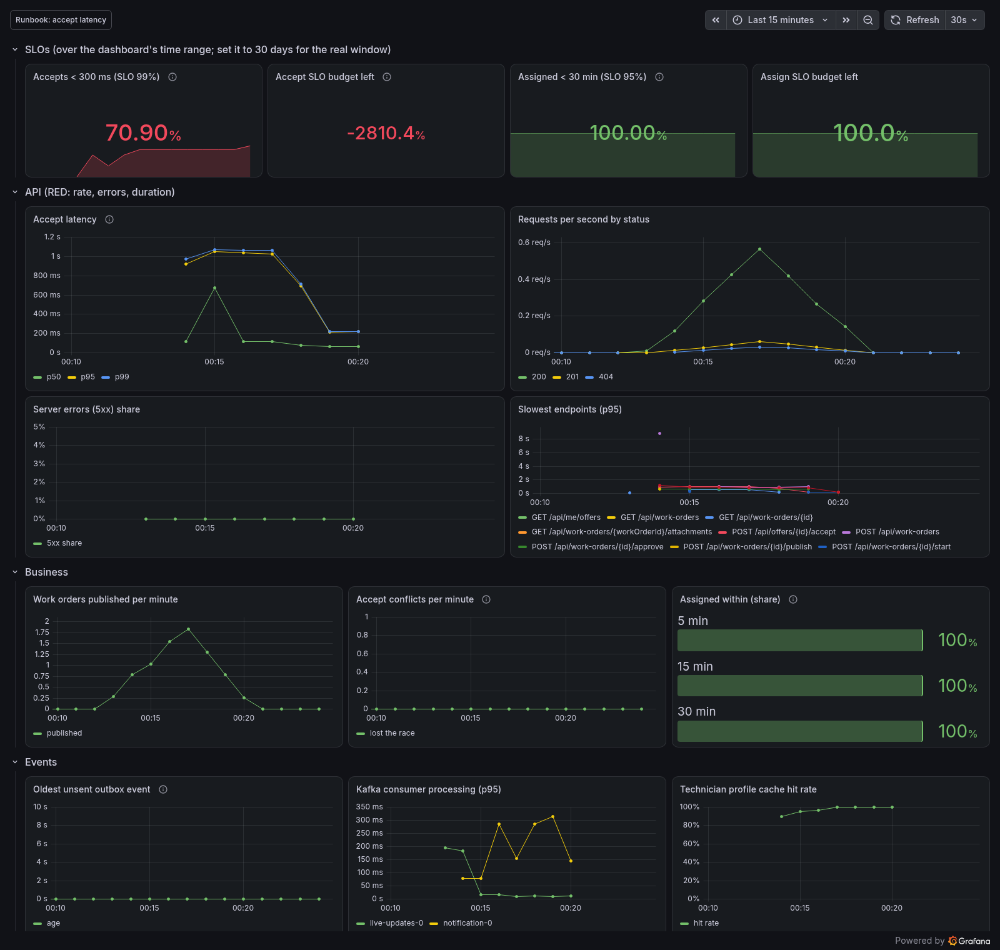

# Dispatch

A multi-tenant marketplace for on-site technical work. A bank needs a POS terminal fixed at its Gulshan branch; Dispatch finds verified technicians nearby with the right skills, offers them the job, makes sure exactly one gets it when several accept at once, collects photo proof straight into object storage, and lets the bank approve the work. Payment, AI checks of completed work and an ops assistant come in later phases.

Built as a portfolio project to show production backend engineering: correctness under concurrency, tenant isolation, measured performance, and failure handling, each proven by tests and written up.

> **Status:** Phase 1 complete (core marketplace). Phase 2 in progress: events, reliability and observability.

## What it does today

| | How | Proof |
|---|---|---|
| **First accept wins** | 50 technicians accept the same job at the same instant: exactly one gets it, the rest get 409. A conditional `UPDATE ... WHERE status = 'ROUTED'` decides inside Postgres, with two more layers behind it. | [ADR 0005](docs/adr/0005-conditional-update-for-job-acceptance.md), `FirstAcceptWinsTests` |
| **Tenant isolation** | Shared schema. Hibernate filters every query by tenant, and Postgres row-level security filters again, so a bug in one layer can't leak another company's data. Technicians see only their own offers. | [ADR 0003](docs/adr/0003-shared-schema-and-row-level-security-for-tenancy.md), `TenantIsolationTests` |
| **Geo search in under a millisecond** | "Verified technicians with these skills within 20 km, nearest first" over 50,000 technicians: 29.5 ms with no indexes, **0.8 ms** after rewriting one condition the planner misjudged (estimated 5 rows, actually 22,500). | [docs/perf/geo-search.md](docs/perf/geo-search.md) |
| **Lifecycle that can't be broken** | A ten-row transition table; every command from every status is tested (90 pairs). Edits need `If-Match`, so nobody overwrites changes they haven't seen (412). | [ADR 0004](docs/adr/0004-hand-written-state-machine.md), [lifecycle](docs/diagrams/work-order-lifecycle.md) |
| **Photos without touching the API** | Presigned URLs signed for one key, content type and size, valid 5 minutes. Confirm checks what arrived, down to the first bytes. Same code on SeaweedFS locally and Amazon S3. | [upload flow](docs/diagrams/attachment-upload.md), `AttachmentApiTests` |
| **Events that can't get lost** | Every lifecycle change goes to Kafka through a transactional outbox: the event row commits with the change, and a relay sends it. Kafka down, or the app killed with `kill -9`: requests keep succeeding and every event arrives later, in order per work order. | [ADR 0006](docs/adr/0006-polling-outbox-before-cdc.md), `OutboxRelayTests` |
| **Consumers that survive real delivery** | The notification consumer deduplicates by event id in the same transaction as its work, retries temporary failures with exponential backoff, and moves poison messages to a dead-letter topic without stopping. Replaying the whole topic notified nobody twice. | [ADR 0008](docs/adr/0008-idempotent-consumers-retries-and-dead-letters.md), `CompanyNotificationsTests` |
| **Live dashboard, email that can wait** | Dispatchers get every change of their company's work orders over server-sent events within a second; every app instance reads every event, so it works behind a load balancer. Emails are queued, sent through a circuit breaker, and retried for hours: with the mail server down, the API doesn't slow down and no email is lost. | [ADR 0007](docs/adr/0007-sse-over-websocket.md), `LiveUpdatesTests`, `EmailSenderTests` |
| **Jobs that run once on many instances** | Work orders nobody takes are offered farther away after 2 hours and escalated to the company after 6. ShedLock runs each round on one instance; every step is also guarded by state and version, so even two runs at once change each work order once. Two instances and a load balancer locally: `--profile cluster`. | [ADR 0009](docs/adr/0009-scheduled-jobs-run-once-with-shedlock-and-idempotent-steps.md), `SlaPolicyTests` |
| **Cache and rate limits that can't take the API down** | Technician profiles are cached in Redis (cache-aside, jittered TTL, single-flight) and evicted after an update commits, so the next read is fresh. Each company gets a token bucket shared by every instance: a burst of 200 gets 100 through, then 429 with `Retry-After`. With Redis down, both step aside: reads come from the database and requests aren't limited. | [ADR 0010](docs/adr/0010-redis-is-optional-cache-and-rate-limits-fail-open.md), `TechnicianProfileCacheTests`, `RateLimitTests` |
| **One trace from request to consumer** | Metrics and traces over OpenTelemetry to Grafana. The request's trace is stored with each outbox event, so one trace runs from the HTTP call through async routing, the outbox relay and Kafka to both consumers. Two SLOs (accepts under 300 ms, assignment within 30 minutes) with error budgets, a burn-rate alert and its runbook. | [trace](docs/images/trace-across-kafka.png), [dashboard](docs/images/observability-dashboard.png), [runbook](docs/runbooks/accept-latency.md) |
| **Fails politely** | Database or storage down: 503 with `Retry-After` within 3 s, readiness `DOWN`, automatic recovery. Every error is RFC 9457 Problem Details. | [docs/failure-modes.md](docs/failure-modes.md) |
| **Chaos day** | Kafka and Redis stopped under traffic: no errors. A lock on one table took the whole API down through the connection pool, and nothing paged. Fixed with database timeouts and an error-rate alert, then the same failure repeated: only the blocked writes failed, fast, and the alert fired. | [postmortem](docs/runbooks/postmortem-2026-11-16.md), [ADR 0011](docs/adr/0011-database-timeouts-on-the-application-role.md), `DatabaseLockTimeoutTests` |
| **AI that can't fail a request** | Every model call goes through one gateway: versioned prompts, a 10 s timeout, retries on 503, a second model when the first is down or hanging, a circuit breaker and rate limit per model, a daily budget per company, phone numbers and emails redacted before sending, and an audit row per attempt. Skill suggestions pick only from skills technicians actually have; with a bad key or the provider down the form still works, without suggestions. | [ADR 0012](docs/adr/0012-ai-gateway-in-front-of-model-providers.md), [measured limits](docs/ai-limits.md), `AiGatewayTests` |

## Architecture

**System context** (C4 level 1):



**Containers** (C4 level 2):



Modules talk through public APIs and events only; Spring Modulith fails the build on a boundary violation. Workorder never calls matching: matching reacts to `WorkOrderPublished` after the commit, and notification to `WorkOrderAssigned`. Other systems get every status change from Kafka, keyed by work order id ([events and topics](docs/diagrams/events-and-topics.md)); notification itself reads them from there to tell the company, as a separate service would. The [context map](docs/diagrams/context-map.md) shows the planned modules (matching, payment, ledger, notification, AI) and the events between them.

**From publish to accept:**



Stack: Spring Boot 4.1, Spring Modulith 2.1, Hibernate 7, Flyway, PostgreSQL 17 + PostGIS + pgvector, Keycloak 26, Kafka 4 (KRaft) with Spring for Apache Kafka, Resilience4j, Redis (Spring Cache, Bucket4j), OpenTelemetry (Grafana LGTM), Thymeleaf email templates, Mailpit, AWS SDK v2 against SeaweedFS, Testcontainers, JUnit 5, Spotless, JaCoCo, GitHub Actions.

## Documentation

- Decisions: [docs/adr](docs/adr) (one per significant choice, with the alternatives)
- Diagrams: [context map](docs/diagrams/context-map.md), [ERD](docs/diagrams/erd.md), [lifecycle](docs/diagrams/work-order-lifecycle.md), [upload flow](docs/diagrams/attachment-upload.md)
- Measurements: [docs/perf](docs/perf), [AI limits and model behaviour](docs/ai-limits.md)
- Operations: [docs/failure-modes.md](docs/failure-modes.md)
- Domain: [event storming](docs/domain/event-storming.md), [glossary](docs/glossary.md)

## Dispatcher web app

The bank's dispatcher sees their work orders change as it happens: a technician accepting or submitting work updates the row within a second, without a reload. From the detail page they publish, approve, or send work back with a reason; new work orders are created with validation from both the browser and the API's Problem Details. Light and dark, desktop and phone. Design system made with ui-ux-pro-max: [`design-system/dispatch`](design-system/dispatch/MASTER.md); details in [`web/README.md`](web/README.md).





## Observability

One publish, one trace: the HTTP request, the async routing, the outbox relay, the Kafka send, and both consumers (company notifications and live updates), even though the event leaves through the outbox later, on another thread. The request's `traceparent` is stored with the outbox event and restored by the relay.



The *Dispatch overview* dashboard: SLOs with error budgets, RED metrics, business metrics, and the outbox and Kafka health. Captured while the full test suite ran on the same laptop: accepts slowed to about 1 s, and the accept SLO dropped to 71% with its error budget overspent, which is what the dashboard is for.



## Getting started

Requirements: Docker, JDK 21+.

```bash
cp .env.example .env
docker compose -f infra/compose/docker-compose.yml up -d --wait postgres keycloak seaweedfs kafka mailpit redis lgtm
cd app && ./mvnw spring-boot:run
```

Optional sample data (3 companies, 50,000 technicians across Bangladesh, 30 work orders around Dhaka and Chattogram; wipes existing data, takes a few seconds):

```bash
docker compose -f infra/compose/docker-compose.yml exec -T postgres psql -U dispatch -d dispatch -v ON_ERROR_STOP=1 < infra/seed/dev-seed.sql
```

- AI (Phase 3): put a Gemini key from Google AI Studio in `.env` as `GEMINI_API_KEY` and start the app with just that value exported (`export $(grep ^GEMINI_API_KEY= ../.env)`; sourcing the whole `.env` would also export its example database passwords). Without it everything else works; AI suggestions say they're unavailable. Free-tier limits and measured behaviour: [docs/ai-limits.md](docs/ai-limits.md)
- Dispatcher web app: `cd web && npm install && npm run dev`, then http://localhost:5173 (sign in as `dispatcher.meghna` / `password`)
- Health: http://localhost:8080/actuator/health
- API docs: http://localhost:8080/swagger-ui/index.html (click **Authorize**, log in as a test user below)
- Keycloak admin console: http://localhost:8180 (admin / admin)
- Object storage (S3 API): http://localhost:8333, bucket `dispatch-media` (created by the app on startup); keys in `infra/compose/seaweedfs/s3.json`
- Two instances behind a load balancer: `cd app && ./mvnw package -DskipTests`, stop the app on 8080, then `docker compose -f infra/compose/docker-compose.yml --profile cluster up -d --build` (http://localhost:8088; Linux host networking)
- Grafana (metrics, traces, dashboards, alerts): http://localhost:3000, folder *Dispatch*
- Mailpit (every email the app sends, nothing leaves the machine): http://localhost:8025
- Live updates: `curl -N -H "Authorization: Bearer $TOKEN" http://localhost:8080/api/live/work-orders`
- Kafka: `localhost:9092`, topic `dispatch.workorder.events.v1` (created by the app on startup). Kafka UI: `docker compose -f infra/compose/docker-compose.yml --profile tools up -d kafka-ui`, then http://localhost:8090

Test users (password `password` for all; local realm only, defined in `infra/compose/keycloak/dispatch-realm.json`):

| Username | Role | Tenant |
|---|---|---|
| `dispatcher.meghna` | DISPATCHER | Meghna Bank |
| `admin.meghna` | CLIENT_ADMIN | Meghna Bank |
| `dispatcher.shwapno` | DISPATCHER | Shwapno Retail |
| `tech.rahim` | TECHNICIAN | none (marketplace-wide); lives in Gulshan, so work orders published nearby are offered to this account |
| `ops.admin` | PLATFORM_ADMIN | none |

Get a token from the command line (the `dispatch-dev-cli` client allows password login for local testing only):

```bash
TOKEN=$(curl -s http://localhost:8180/realms/dispatch/protocol/openid-connect/token \
  -d grant_type=password -d client_id=dispatch-dev-cli -d username=dispatcher.meghna -d password=password | jq -r .access_token)
curl -s localhost:8080/api/me -H "Authorization: Bearer $TOKEN"
```

Tests use Testcontainers and the same Postgres image, so build it once first:

```bash
docker compose -f infra/compose/docker-compose.yml build postgres
cd app && ./mvnw verify
```

`verify` also checks formatting (Spotless, Palantir style) and writes a coverage report to `app/target/site/jacoco/index.html`. Fix formatting with `./mvnw spotless:apply`. CI runs the same build on every push and pull request.

## Demo

With the stack running and the seed loaded, one script walks through the whole story with real logins: publish, offers, a double-tapped accept, start, a photo upload straight to storage, submit, approve, and another company getting 404.

```bash
./scripts/demo.sh
```

Press Enter between steps, or run it straight through with `DEMO_FAST=1`. A 3-minute talk track to record alongside it: [docs/demo.md](docs/demo.md).

## Repository layout

```
app/              Spring Boot modular monolith
infra/compose/    Local Docker Compose stack
infra/helm/       Kubernetes Helm chart (later)
load-tests/       k6 scripts
evals/            AI evaluation datasets and results
docs/adr/         Architecture decision records
docs/diagrams/    Context map, ERD, sequence diagrams
docs/learning/    Learning journal and open questions
docs/runbooks/    Operational runbooks and postmortems
scripts/          Demo script
docs/perf/        Performance measurements
```
