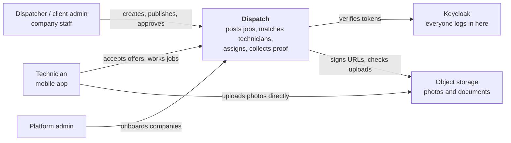
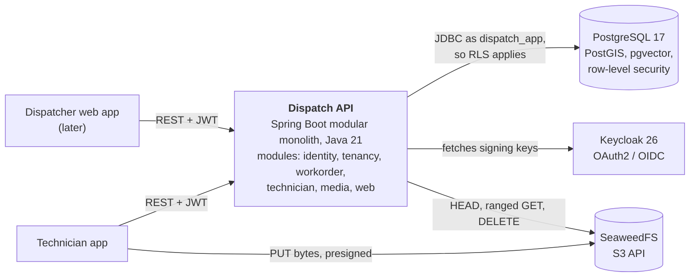
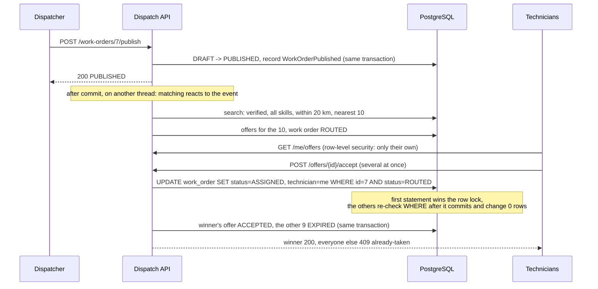

# Dispatch

A multi-tenant marketplace for on-site technical work. A bank needs a POS terminal fixed at its Gulshan branch; Dispatch finds verified technicians nearby with the right skills, offers them the job, makes sure exactly one gets it when several accept at once, collects photo proof straight into object storage, and lets the bank approve the work. Payment, AI checks of completed work and an ops assistant come in later phases.

Built as a portfolio project to show production backend engineering: correctness under concurrency, tenant isolation, measured performance, and failure handling, each proven by tests and written up.

> **Status:** Phase 1 complete (core marketplace). Phase 2 in progress: events, reliability and observability.

## What it does today

| | How | Proof |
|---|---|---|
| **First accept wins** | 50 technicians accept the same job at the same instant: exactly one gets it, the rest get 409. A conditional `UPDATE ... WHERE status = 'ROUTED'` decides inside Postgres, with two more layers behind it. | [ADR 0005](docs/adr/0005-conditional-update-for-job-acceptance.md), `FirstAcceptWinsTests` |
| **Tenant isolation** | Shared schema. Hibernate filters every query by tenant, and Postgres row-level security filters again, so a bug in one layer can't leak another company's data. Technicians see only their own offers. | [ADR 0003](docs/adr/0003-shared-schema-and-row-level-security-for-tenancy.md), `TenantIsolationTests` |
| **Geo search in under a millisecond** | "Verified technicians with these skills within 20 km, nearest first" over 50,000 technicians: 29.5 ms with no indexes, **0.8 ms** after rewriting one condition the planner misjudged (estimated 5 rows, actually 22,500). | [docs/perf/geo-search.md](docs/perf/geo-search.md) |
| **Lifecycle that can't be broken** | A ten-row transition table; every command from every status is tested (90 pairs). Edits need `If-Match`, so nobody overwrites changes they haven't seen (412). | [ADR 0004](docs/adr/0004-hand-written-state-machine.md), [lifecycle](docs/diagrams/work-order-lifecycle.md) |
| **Photos without touching the API** | Presigned URLs signed for one key, content type and size, valid 5 minutes. Confirm checks what arrived, down to the first bytes. Same code on SeaweedFS locally and Amazon S3. | [upload flow](docs/diagrams/attachment-upload.md), `AttachmentApiTests` |
| **Fails politely** | Database or storage down: 503 with `Retry-After` within 3 s, readiness `DOWN`, automatic recovery. Every error is RFC 9457 Problem Details. | [docs/failure-modes.md](docs/failure-modes.md) |

## Architecture

**System context** (C4 level 1):



**Containers** (C4 level 2):



Modules talk through public APIs and events only; Spring Modulith fails the build on a boundary violation. Workorder never calls matching: matching reacts to `WorkOrderPublished` after the commit, and notification to `WorkOrderAssigned`. The [context map](docs/diagrams/context-map.md) shows the planned modules (matching, payment, ledger, notification, AI) and the events between them.

**From publish to accept:**



Stack: Spring Boot 4.1, Spring Modulith 2.1, Hibernate 7, Flyway, PostgreSQL 17 + PostGIS + pgvector, Keycloak 26, AWS SDK v2 against SeaweedFS, Testcontainers, JUnit 5, Spotless, JaCoCo, GitHub Actions.

## Documentation

- Decisions: [docs/adr](docs/adr) (one per significant choice, with the alternatives)
- Diagrams: [context map](docs/diagrams/context-map.md), [ERD](docs/diagrams/erd.md), [lifecycle](docs/diagrams/work-order-lifecycle.md), [upload flow](docs/diagrams/attachment-upload.md)
- Measurements: [docs/perf](docs/perf)
- Operations: [docs/failure-modes.md](docs/failure-modes.md)
- Domain: [event storming](docs/domain/event-storming.md), [glossary](docs/glossary.md)

## Getting started

Requirements: Docker, JDK 21+.

```bash
cp .env.example .env
docker compose -f infra/compose/docker-compose.yml up -d --wait postgres keycloak seaweedfs
cd app && ./mvnw spring-boot:run
```

Optional sample data (3 companies, 50,000 technicians across Bangladesh, 30 work orders around Dhaka and Chattogram; wipes existing data, takes a few seconds):

```bash
docker compose -f infra/compose/docker-compose.yml exec -T postgres psql -U dispatch -d dispatch -v ON_ERROR_STOP=1 < infra/seed/dev-seed.sql
```

- Health: http://localhost:8080/actuator/health
- API docs: http://localhost:8080/swagger-ui/index.html (click **Authorize**, log in as a test user below)
- Keycloak admin console: http://localhost:8180 (admin / admin)
- Object storage (S3 API): http://localhost:8333, bucket `dispatch-media` (created by the app on startup); keys in `infra/compose/seaweedfs/s3.json`

Test users (password `password` for all; local realm only, defined in `infra/compose/keycloak/dispatch-realm.json`):

| Username | Role | Tenant |
|---|---|---|
| `dispatcher.meghna` | DISPATCHER | Meghna Bank |
| `admin.meghna` | CLIENT_ADMIN | Meghna Bank |
| `dispatcher.shwapno` | DISPATCHER | Shwapno Retail |
| `tech.rahim` | TECHNICIAN | none (marketplace-wide); lives in Gulshan, so work orders published nearby are offered to this account |
| `ops.admin` | PLATFORM_ADMIN | none |

Get a token from the command line (the `dispatch-dev-cli` client allows password login for local testing only):

```bash
TOKEN=$(curl -s http://localhost:8180/realms/dispatch/protocol/openid-connect/token \
  -d grant_type=password -d client_id=dispatch-dev-cli -d username=dispatcher.meghna -d password=password | jq -r .access_token)
curl -s localhost:8080/api/me -H "Authorization: Bearer $TOKEN"
```

Tests use Testcontainers and the same Postgres image, so build it once first:

```bash
docker compose -f infra/compose/docker-compose.yml build postgres
cd app && ./mvnw verify
```

`verify` also checks formatting (Spotless, Palantir style) and writes a coverage report to `app/target/site/jacoco/index.html`. Fix formatting with `./mvnw spotless:apply`. CI runs the same build on every push and pull request.

## Demo

With the stack running and the seed loaded, one script walks through the whole story with real logins: publish, offers, a double-tapped accept, start, a photo upload straight to storage, submit, approve, and another company getting 404.

```bash
./scripts/demo.sh
```

Press Enter between steps, or run it straight through with `DEMO_FAST=1`. A 3-minute talk track to record alongside it: [docs/demo.md](docs/demo.md).

## Repository layout

```
app/              Spring Boot modular monolith
infra/compose/    Local Docker Compose stack
infra/helm/       Kubernetes Helm chart (later)
load-tests/       k6 scripts
evals/            AI evaluation datasets and results
docs/adr/         Architecture decision records
docs/diagrams/    Context map, ERD, sequence diagrams
docs/learning/    Learning journal and open questions
docs/runbooks/    Operational runbooks and postmortems
scripts/          Demo script
docs/perf/        Performance measurements
```
