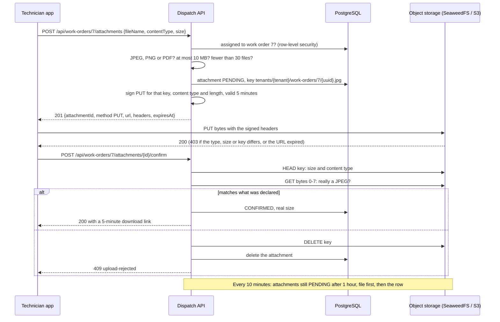

# Attachment upload

Photos and documents go straight from the phone to object storage. The API never receives file bytes: it decides who may upload what, signs a short-lived URL, and checks what arrived. Code: the `media` module.

## What stops what

| Attempt | Stopped by |
|---|---|
| Uploading to a work order you aren't assigned to, or another company's | 404 before any URL is issued (`WorkOrderAccess`, row-level security) |
| Uploading a 2 GB video | 400 before any URL is issued (declared size); storage refuses bytes that don't match the signed length; confirm checks the stored size again |
| Renaming `setup.exe` to `router.jpg` | Storage refuses a content type other than the signed one; confirm reads the first bytes and deletes anything that isn't a real JPEG, PNG or PDF |
| Editing the URL to write into another tenant's folder | The signature covers the key: storage answers 403 |
| Sharing a download link | It expires after 5 minutes; the bucket itself is private |
| Starting uploads and never finishing | Cleanup deletes them after an hour |

## Same code on AWS

Only configuration changes: `dispatch.storage.endpoint` to `https://s3.<region>.amazonaws.com`, real credentials (or an IAM role), and `create-bucket: false`. The SDK calls, presigning and checks stay the same.

Not done yet: CORS on the bucket (needed once a browser uploads directly; phones don't need it), decoding images and stripping EXIF location data (step 3.5), malware scanning (before real users).
