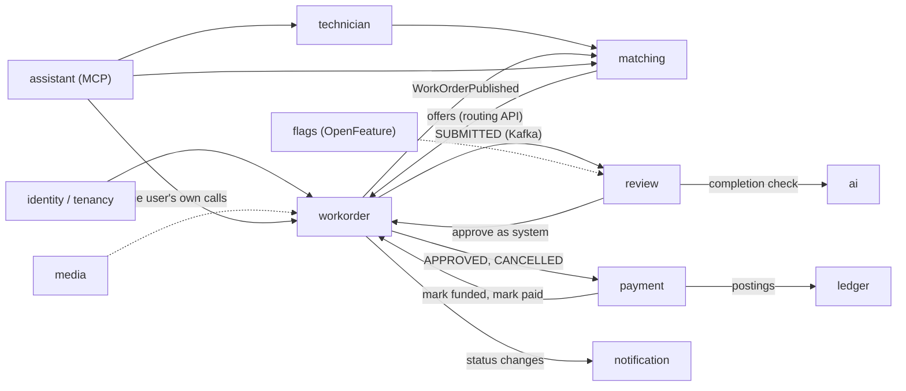

# Context Map

Each bounded context becomes one Spring Modulith module. Arrows show who reacts to whom; labels are the events that cross the boundary.

## Module ownership

| Module | Owns (data and rules) | Does not own |
|---|---|---|
| `identity` / `tenancy` | Tenants, tenant users, tenant context per request | Technician profiles |
| `technician` | Technician profiles, skills, home location, service radius, verification | Offers |
| `workorder` | Work orders, checklist, lifecycle and its rules, offers and acceptance | Matching algorithm, money |
| `matching` | Ranking technicians for a work order, re-routing | Offer state |
| `media` | Attachments, presigned upload and download | Who may see a work order |
| `payment` | Payment provider integration, escrow funding, payouts | Accounting entries |
| `ledger` | Double-entry accounts and journal entries | Payment provider calls |
| `notification` | Email and in-app messages | Business decisions |
| `ai` | AI gateway, intake parsing, the completion check, prompts | Final approval decisions |
| `review` | Completion audits, the approval policy, the review queue, the auto-approval experiment | The vision model call |
| `flags` | Feature flags, rollouts, their audit; read through OpenFeature | What a flag means to a feature |
| `assistant` | MCP tools for AI clients, confirmations for writes, the tool-call audit | Any rule the services already enforce |

## Rules

- Modules talk through their public API or events, never through another module's tables.
- Offers live in `workorder` (not `matching`) because accepting an offer and assigning the work order must change together in one transaction.
- Exceptions need an ADR.
