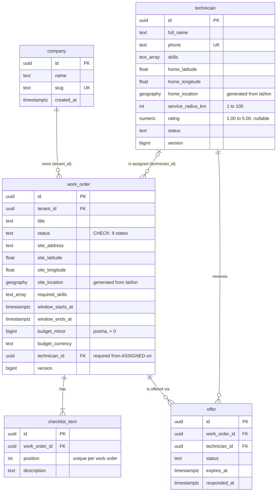

# Entity relationship diagram

Source of truth: the Flyway migrations in `app/src/main/resources/db/migration`. Update this file in the same pull request as any schema change.

## Aggregates

| Aggregate (root) | Tables | Module |
|---|---|---|
| `Company` | `company` | `tenancy` |
| `Technician` | `technician` | `technician` |
| `WorkOrder` | `work_order`, `checklist_item` | `workorder` |
| `Offer` | `offer` | `workorder` |

Aggregates point at each other with ID columns, never with Java object references (see [ADR 0002](../adr/0002-aggregates-reference-each-other-by-id.md)). Foreign keys still exist in the database: an ID reference in code is a design choice, but data integrity is non-negotiable.

## Rules the database enforces

| Rule | How |
|---|---|
| Status is one of the known values | `CHECK (status IN (...))` |
| An assigned (or later) work order has a technician | `work_order_assigned_has_technician` |
| At most one accepted offer per work order | partial unique index `offer_one_accepted_per_work_order` |
| A technician gets at most one offer per work order | `offer_once_per_technician` |
| Money is positive and in minor units | `budget_minor BIGINT CHECK (> 0)` |
| Time window ends after it starts | `work_order_window_valid` |
