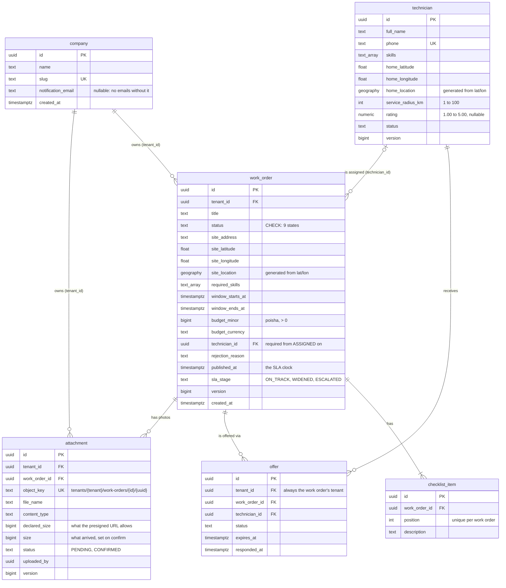
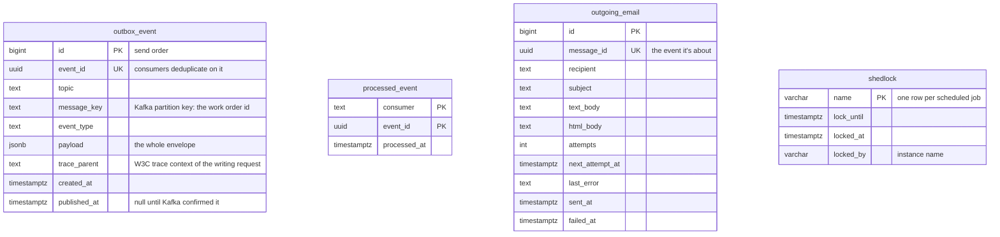
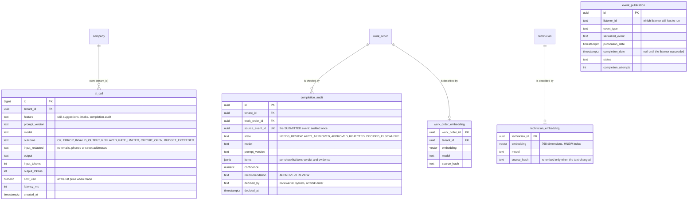
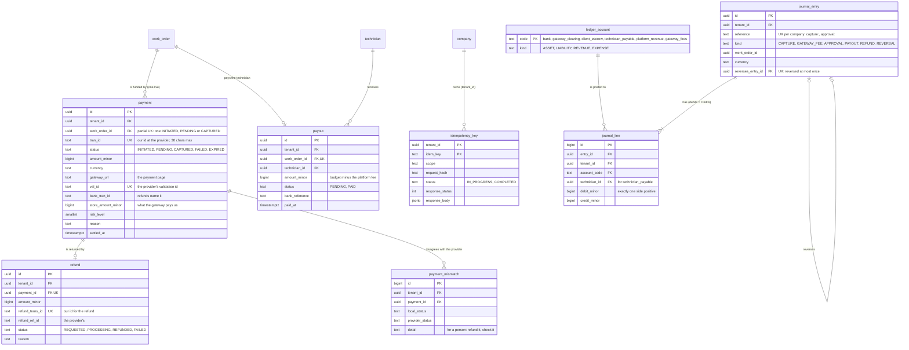

# Entity relationship diagram

Source of truth: the Flyway migrations in `app/src/main/resources/db/migration`. Update this file in the same pull request as any schema change.

## Infrastructure tables

Not domain data: no tenant, no row-level security, no foreign keys. Each serves the reliability machinery of Phase 2.

| Table | Written by | Read by | ADR / topic |
|---|---|---|---|
| `outbox_event` | the business transaction (`Outbox.append`) | `OutboxRelay`, which sends to Kafka | [ADR 0006](../adr/0006-polling-outbox-before-cdc.md), T17 |
| `processed_event` | each Kafka consumer, with its work | the same consumer, to skip duplicates | [ADR 0008](../adr/0008-idempotent-consumers-retries-and-dead-letters.md), T19 |
| `outgoing_email` | the notification consumer | `EmailSender`, through a circuit breaker | T20 |
| `shedlock` | ShedLock, around scheduled jobs | ShedLock on every instance | [ADR 0009](../adr/0009-scheduled-jobs-run-once-with-shedlock-and-idempotent-steps.md), T22 |
| `event_publication` | Spring Modulith, with in-process events | Spring Modulith, to redeliver incomplete events | T16 |

## Aggregates

| Aggregate (root) | Tables | Module |
|---|---|---|
| `Company` | `company` | `tenancy` |
| `Technician` | `technician` | `technician` |
| `WorkOrder` | `work_order`, `checklist_item` | `workorder` |
| `Offer` | `offer` | `workorder` |
| `Attachment` | `attachment` | `media` |

Aggregates point at each other with ID columns, never with Java object references (see [ADR 0002](../adr/0002-aggregates-reference-each-other-by-id.md)). Foreign keys still exist in the database: an ID reference in code is a design choice, but data integrity is non-negotiable.

## Rules the database enforces

| Rule | How |
|---|---|
| Status is one of the known values | `CHECK (status IN (...))` |
| An assigned (or later) work order has a technician | `work_order_assigned_has_technician` |
| At most one accepted offer per work order | partial unique index `offer_one_accepted_per_work_order` |
| A technician gets at most one offer per work order | `offer_once_per_technician` |
| Money is positive and in minor units | `budget_minor BIGINT CHECK (> 0)` |
| Time window ends after it starts | `work_order_window_valid` |
| A tenant sees and writes only its own work orders, checklists and offers | row-level security policies `tenant_isolation` (V4, [ADR 0003](../adr/0003-shared-schema-and-row-level-security-for-tenancy.md)) |
| A technician reads only their own offers and the work orders offered or assigned to them | row-level security policies `technician_reads_own_offers`, `technician_reads_offered_work` (V7, [ADR 0005](../adr/0005-conditional-update-for-job-acceptance.md)) |
| An offer's tenant is its work order's tenant | composite foreign key `offer_work_order_same_tenant` (V7) |
| A work order has at most one open or captured payment | partial unique index `payment_one_live_per_work_order` (V19) |
| Every journal entry balances (debits = credits, at least two lines) | deferred constraint triggers `journal_entry_balanced`, `journal_line_balanced`, checked at commit (V20, [ADR 0017](../adr/0017-double-entry-ledger-in-postgresql.md)) |
| The ledger is append-only | `UPDATE`, `DELETE` and `TRUNCATE` revoked from the app role, plus triggers that refuse them for everyone (V20) |

`company` and `technician` are not tenant-owned: companies are the tenant list, and technicians work for many companies.

## Events, AI and matching (Phases 2 and 3)

Kept apart from the diagram above so each stays readable. Row-level security applies to every table with a `tenant_id`.

## Money (Phase 4)

Payments, refunds and payouts record what happened at the provider and the bank; the ledger records where the money is. Journal tables are append-only (V20).

