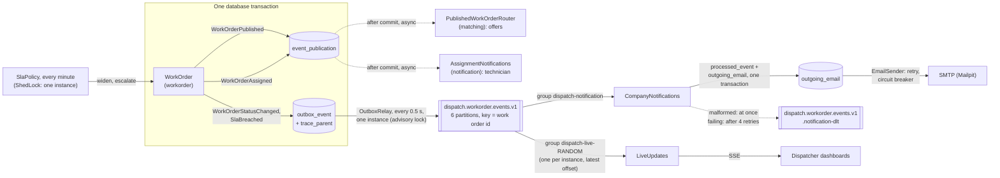

# Events and topics

How a work order change travels after the database commit (Phase 2). Two kinds of events, for two jobs:

- **In-process domain events** (Spring Modulith, T16): one module reacting to another inside the app. Stored in `event_publication` with the change and redelivered if a listener fails.
- **Kafka events** (T17, T18): the public record of what happened, for consumers that could live in other services. Written to `outbox_event` with the change and sent by the relay.

## Topics

| Topic | Partitions | Key | Event types | Producers | Consumer groups |
|---|---|---|---|---|---|
| `dispatch.workorder.events.v1` | 6 | work order id: one work order's events stay in order | `work-order.status-changed` v1, `work-order.sla-breached` v1 | `OutboxRelay` only | `dispatch-notification` (emails, at least once, deduplicated), `dispatch-live-<random>` (one per app instance, SSE, best effort) |
| `dispatch.workorder.events.v1.notification-dlt` | 6 (same partition as the original) | same | whatever `dispatch-notification` couldn't process, with the exception in headers | the notification consumer's error handler | none: inspected and replayed by hand |

Every message: the envelope (`eventId`, `type`, `version`, `occurredAt`, `tenantId`, `aggregateId`, `payload`) as JSON, headers `eventId`, `eventType` and the W3C `traceparent` of the request that caused it.

## Event contracts

| Event | Where | Payload | Rules |
|---|---|---|---|
| `WorkOrderPublished` | in-process | id, tenant, site, required skills | matching's input (event-carried state) |
| `WorkOrderAssigned` | in-process | id, tenant, technician, title | tells the technician |
| `work-order.status-changed` v1 | Kafka | `WorkOrderStatusChangedV1`: id, title, from, to, technician, occurredAt | public contract: add fields, never rename or remove; breaking changes get v2 on a new topic |
| `work-order.sla-breached` v1 | Kafka | `WorkOrderSlaBreachedV1`: id, title, waitingSince, occurredAt | added in step 2.5; consumers that don't know it ignore it |

## Scheduled jobs

| Job | Every | Runs on | Why that way |
|---|---|---|---|
| `OutboxRelay.run` | 0.5 s | one instance at a time (advisory lock per batch) | keeps per-key order |
| `EmailSender.run` | 2 s | every instance, each takes different rows (`SKIP LOCKED`) | a queue: more instances, more throughput |
| `SlaPolicy.run` | 1 min | one instance (ShedLock) | each step also guarded by state and `@Version` |
| Outbox, processed-event, abandoned-upload cleanups | daily / 10 min | one instance (ShedLock) | deletes are idempotent anyway |
| `LiveUpdates.keepAlive` | 20 s | every instance | each instance's own connections |
