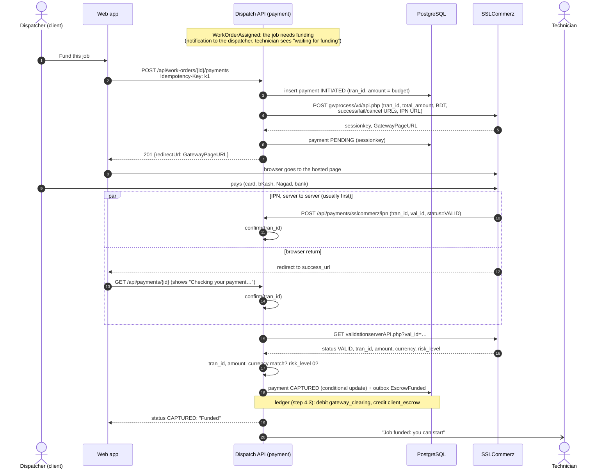
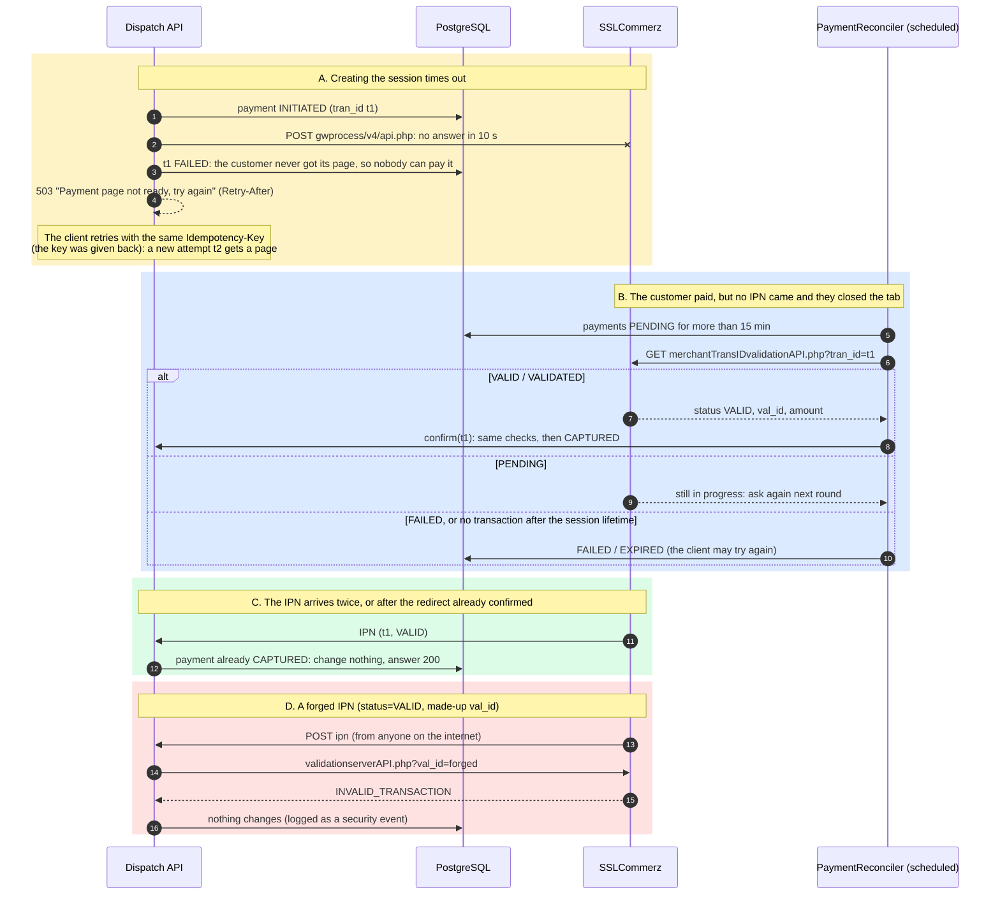
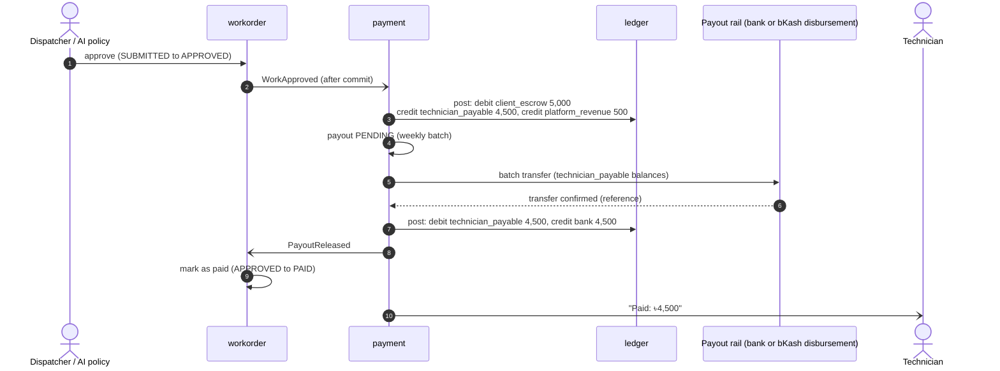
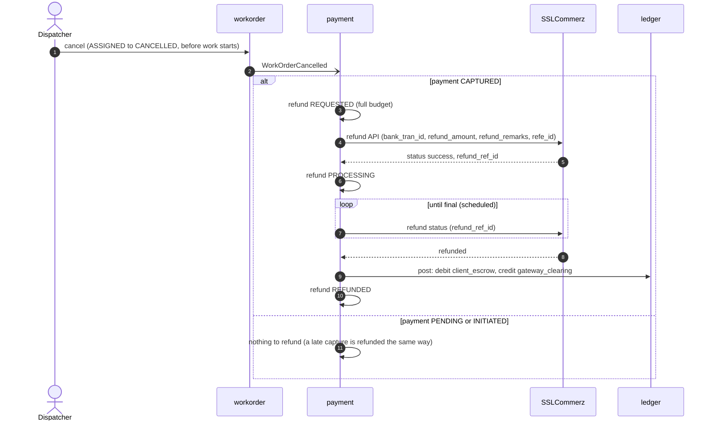
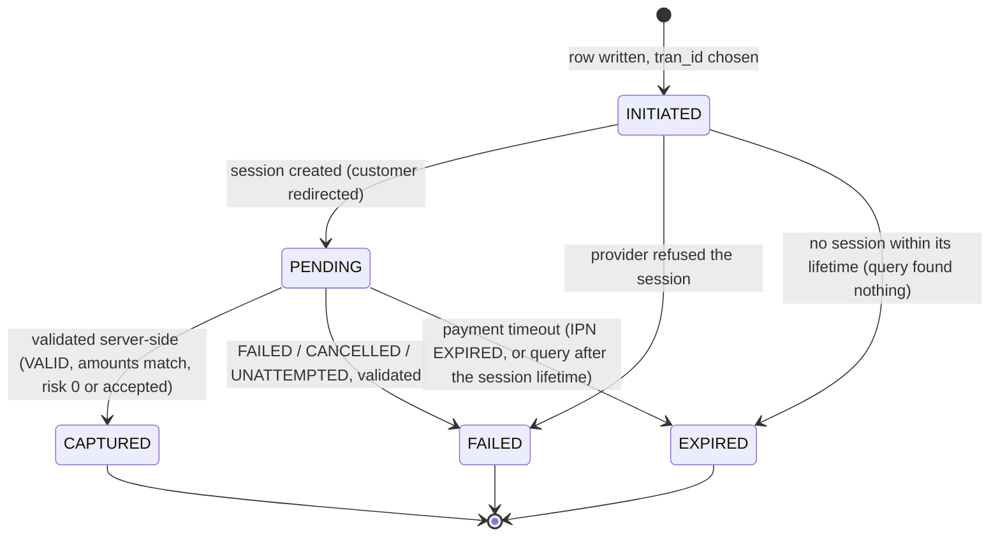

# Payment flow

The money design for Phase 4 (step 4.1), before any payment code. It follows the event storming decision ([event-storming.md](../domain/event-storming.md), rule 3): **the client funds escrow once a technician is assigned, before work starts, and the payout is released when the work is approved.** Why this shape: [ADR 0015](../adr/0015-escrow-funded-at-assignment-released-at-approval.md). Concepts: T33 (payment gateway integration).

Provider: **SSLCommerz** hosted checkout (sandbox first). One integration covers cards, mobile banking (bKash, Nagad, Rocket) and internet banking, and the customer pays on SSLCommerz's page, so card data never touches Dispatch. Names below are SSLCommerz v4's (`tran_id`, `val_id`, `sessionkey`, `bank_tran_id`); a `PaymentProvider` interface (step 4.2) keeps them inside one adapter.

## The rules

1. **The browser is never the source of truth.** The customer's return to `success_url` only shows "Checking your payment…". Only a server-to-server check marks a payment captured: the Order Validation API with the `val_id`, or the Transaction Query API with our `tran_id`.
2. **Check what you asked for.** A capture counts only if the provider says `VALID` (or `VALIDATED`: valid, asked before) **and** `tran_id`, amount and currency match our payment row. Anything else is logged and the payment stays as it was.
3. **IPN, redirect and polling all funnel into one idempotent `confirm(tranId)`.** Whichever arrives first does the work; the rest find the payment already final and change nothing (state change by conditional update, unique `val_id`).
4. **Unknown is a state, not an error.** A timeout means "we don't know yet", never "failed": a payment the customer could have paid stays as it is and is resolved by asking the provider (status query), never by trying again with a new transaction. The one exception is safe by construction: if creating the payment page fails, the customer never saw a page, so nobody can pay that attempt; it's closed at once and a retry starts a new one.
5. **Money is integers.** Minor units (paisa) in `Money`; the provider's `decimal(10,2)` is converted at the adapter, never inside the domain.
6. **One work order, one captured payment.** A new attempt is allowed only when the previous one is final and not captured (`FAILED`, `EXPIRED`). A partial unique index enforces it.

## Funding: the happy path

- **Who pays:** a dispatcher or client admin of the company, from the work order page (status `ASSIGNED`, "Fund this job").
- **Amount:** the work order's budget, fixed when it was published. The technician's payout is computed from it, so the amount can't change after assignment.
- **Start is gated:** `START` (ASSIGNED to IN_PROGRESS) requires a captured payment. Switched off by `dispatch.payments.required=false` for local runs without a sandbox account, so the Phase 1-3 demo keeps working.
- **Risk:** SSLCommerz flags risky transactions with `risk_level=1` and asks merchants to hold the service. Such a payment stays `PENDING` with reason "risk review" until a platform admin accepts it (captured) or refunds it.

## When the outcome is unknown

- **The IPN endpoint is public and untrusted.** It's only a hint about which `tran_id` to check. Every fact comes from the validation call, made by us, to SSLCommerz, with the store credentials.
- **Daily reconciliation** (step 4.2) also compares every payment changed in the last day with the provider's status and reports mismatches: a capture the provider doesn't know, or a provider `VALID` that we have as `FAILED`.

## Approval: releasing the payout

- **Fee split:** platform fee 10% of the budget (configurable), computed in integers with the remainder going to the technician, so the two parts always add up to the budget.
- **Gateway charges:** SSLCommerz pays out `store_amount` (the amount minus its charge, about 2.5%). The platform bears it: the difference is posted from `gateway_clearing` to a `gateway_fees` expense when the settlement arrives, so the technician's share never depends on how the client paid.
- **Payout rail:** SSLCommerz takes payments; it has no API to pay technicians. Payouts go out as a weekly batch through a bank transfer or bKash disbursement, behind a `PayoutProvider`. Until one is integrated, a platform admin uploads the bank's confirmation and the payout is marked confirmed by hand; the ledger and `PAID` status behave the same either way.

## Cancelling and refunds

- Work can't be cancelled once started (`CANCEL` isn't allowed from `IN_PROGRESS`), so a refund is always the full amount. Disputes after work started (who pays for the visit?) are a business process, out of scope.
- A rejected submission (SUBMITTED to IN_PROGRESS) doesn't touch the money: escrow stays funded while the technician fixes the work.

## Payment states

| State | Meaning | Who moves it | Final? |
|---|---|---|---|
| `INITIATED` | We wrote the row and chose `tran_id`; the provider may or may not have a session | create call; reconciler | no |
| `PENDING` | The customer has a payment page; the outcome isn't known yet (also: risk review) | create call | no |
| `CAPTURED` | Money confirmed server-side and held in escrow | `confirm()` | yes |
| `FAILED` | Declined, cancelled by the customer, or refused | `confirm()`, reconciler | yes: a new attempt may start |
| `EXPIRED` | Nobody paid in time | IPN `EXPIRED`, reconciler | yes: a new attempt may start |

Refunds are their own records (`REQUESTED -> PROCESSING -> REFUNDED / FAILED`), because a captured payment stays captured: the refund is a second movement of money, and the ledger shows both (step 4.3).

## Ledger postings (preview of step 4.3)

| Event | Debit | Credit | Example (budget ৳5,000) |
|---|---|---|---|
| Escrow funded (captured) | `gateway_clearing` | `client_escrow` | 5,000 |
| Settlement from SSLCommerz | `bank` 4,875 and `gateway_fees` 125 | `gateway_clearing` 5,000 | charge about 2.5% |
| Work approved | `client_escrow` 5,000 | `technician_payable` 4,500 and `platform_revenue` 500 | fee 10% |
| Payout sent | `technician_payable` | `bank` | 4,500 |
| Refund (cancelled before start) | `client_escrow` | `gateway_clearing` | 5,000 |

Every entry's debits equal its credits; corrections are reversing entries, never updates.

## Built in step 4.2

- `payment` module: `PaymentService` (start, one `confirm()`), `SslCommerz` (the provider adapter), `PaymentReconciler` (every minute: open payments older than 15 minutes; every night at 03:00 Dhaka: the last day against the provider into `payment_mismatch`), `IdempotencyKeys` ([ADR 0016](../adr/0016-idempotency-keys-for-payment-apis.md)).
- API: `POST /api/work-orders/{id}/payments` (requires `Idempotency-Key`), `GET /api/work-orders/{id}/payment`; public: `POST /api/payments/sslcommerz/ipn` and `/return`.
- `FakeSslCommerz`: a stand-in at `/fake-sslcommerz` with the same endpoints and fields, for local runs and demos without a sandbox store. Its page has Pay, "Pay but lose the notification", Card declined and Cancel.
- The work order page has a Payment panel; `scripts/demo.sh` pays before Rahim starts.
- Refunds on cancel and the payout on approval come with the ledger (step 4.3): their postings are the point.

## Not in this design

- Partial payments, tips, changing the budget after assignment: one fixed amount per job.
- Disputes and chargebacks: a chargeback would be a reversing entry against `platform_revenue` and is handled by people.
- Currencies other than BDT.
