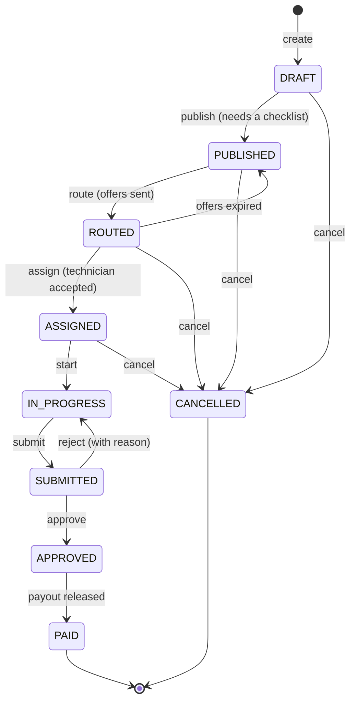
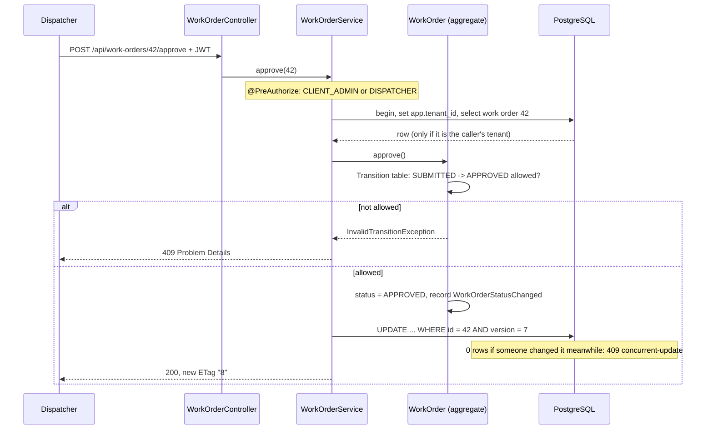
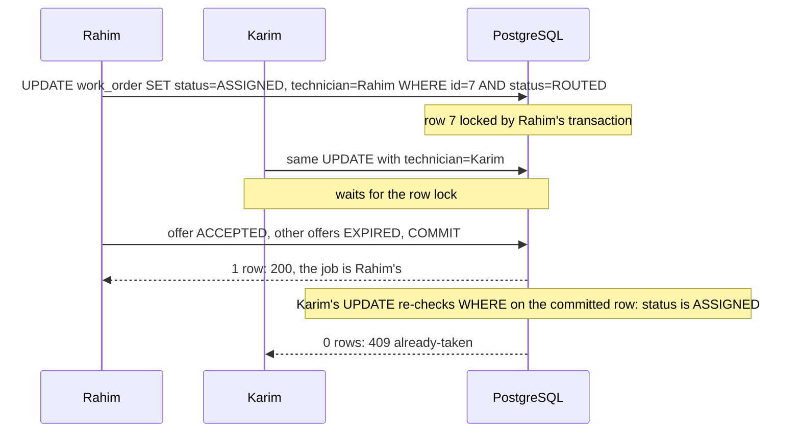

# Work order lifecycle

Source of truth: `Transition` in the `workorder` module. `WorkOrderTransitionsTest` checks every command from every status against this table. Why it's hand-written: [ADR 0004](../adr/0004-hand-written-state-machine.md).



| Command | From | To | Who triggers it | API |
|---|---|---|---|---|
| publish | DRAFT | PUBLISHED | Dispatcher, client admin | `POST /api/work-orders/{id}/publish` (then routes, see next row) |
| route | PUBLISHED | ROUTED | Publishing, when technicians in range have the skills: offers go to the nearest 10 | (part of publish) |
| offers expired | ROUTED | PUBLISHED | Scheduled job (step 2.5) | - |
| assign | ROUTED | ASSIGNED | Technician accepts an offer; the first one wins ([ADR 0005](../adr/0005-conditional-update-for-job-acceptance.md)) | `POST /api/offers/{id}/accept` |
| start | ASSIGNED | IN_PROGRESS | The assigned technician | `POST /api/work-orders/{id}/start` |
| submit | IN_PROGRESS | SUBMITTED | The assigned technician | `POST /api/work-orders/{id}/submit` |
| approve | SUBMITTED | APPROVED | Dispatcher, client admin | `POST /api/work-orders/{id}/approve` |
| reject | SUBMITTED | IN_PROGRESS | Dispatcher, client admin | `POST /api/work-orders/{id}/reject` |
| mark paid | APPROVED | PAID | Payment (Phase 4) | - |
| cancel | DRAFT, PUBLISHED, ROUTED, ASSIGNED | CANCELLED | Dispatcher, client admin | `POST /api/work-orders/{id}/cancel` |

Anything else gets **409** with Problem Details, for example:

```json
{
  "type": "urn:dispatch:problem:invalid-transition",
  "title": "Not allowed in the current state",
  "status": 409,
  "detail": "Can't approve a work order that is CANCELLED",
  "currentStatus": "CANCELLED",
  "action": "approve"
}
```

## A request through the layers



## Editing a draft safely

Edits (`PATCH /api/work-orders/{id}`) need `If-Match` with the ETag from your last read:

- Missing `If-Match`: **428**.
- Someone saved in between: **412**. Reload and edit again.
- The work order isn't a draft any more: **409**.

## Two technicians accept at once


