# Event Storming (lightweight)

Status: draft for review. Challenge anything that doesn't match how field service really works.

How to read this: **events** are facts that happened (past tense). **Commands** are what someone asked for. **Actors** issue commands. **Policies** are automatic reactions: "when X happens, do Y".

## 1. Actors

| Actor | Who | Belongs to a tenant? |
|---|---|---|
| Client admin | Manages a client company's account, users and billing | Yes |
| Dispatcher | Creates, publishes, reviews and approves work orders for a client company | Yes |
| Technician | Freelancer who accepts and performs jobs for many companies | **No** (marketplace-wide) |
| Platform admin | Runs Dispatch itself: onboards tenants, verifies technicians | No |
| System | Scheduled jobs, AI audit, payment callbacks | Acts on behalf of a tenant per event |

## 2. The main flow (happy path)

```mermaid
flowchart LR
  E1["WorkOrderDrafted"] --> E2["WorkOrderPublished"]
  E2 --> E3["OffersSent"]
  E3 --> E4["OfferAccepted"]
  E4 --> E5["WorkOrderAssigned"]
  E5 --> E6["EscrowFunded"]
  E6 --> E7["WorkStarted"]
  E7 --> E8["WorkSubmitted"]
  E8 --> E9["AuditCompleted"]
  E9 --> E10["WorkApproved"]
  E10 --> E11["PayoutReleased"]
```

| # | Event | Caused by (actor: command) | Data it carries |
|---|---|---|---|
| 1 | `WorkOrderDrafted` | Dispatcher: create draft (form or AI intake from text) | title, description, site location, required skills, time window, checklist, budget |
| 2 | `WorkOrderPublished` | Dispatcher: publish | work order id, tenant id |
| 3 | `OffersSent` | System (policy P1) | work order id, technician ids, offer expiry |
| 4 | `OfferAccepted` | Technician: accept offer | offer id, technician id |
| 5 | `WorkOrderAssigned` | System, same transaction as 4 (first accept wins) | work order id, technician id |
| 6 | `EscrowFunded` | Payment provider callback after client pays | payment id, amount |
| 7 | `WorkStarted` | Technician: start (on site) | started at |
| 8 | `WorkSubmitted` | Technician: submit (notes + photos) | notes, attachment ids, checklist answers |
| 9 | `AuditCompleted` | System: AI completion audit (policy P5) | per-item verdict, confidence, model and prompt version |
| 10 | `WorkApproved` | Dispatcher: approve, or System: auto-approve (policy P6) | approved by (user or system) |
| 11 | `PayoutReleased` | System (policy P7) | amount to technician, platform fee |

## 3. Other paths

| Event | Caused by | What follows |
|---|---|---|
| `OfferDeclined` | Technician: decline | Nothing yet; if all offers end without acceptance, P2 |
| `OfferExpired` | System: offer expiry time passed | If all offers expired, P2 |
| `OffersExhausted` | System: every offer declined or expired | P2: re-route with wider radius |
| `SlaBreached` | System: scheduled check (P3) | Re-route or escalate to dispatcher |
| `WorkRejected` | Dispatcher: reject with reason | Back to IN_PROGRESS; technician fixes and resubmits |
| `ReviewRequested` | System: audit not confident (P6) | Dispatcher review queue |
| `WorkOrderCancelled` | Dispatcher: cancel (only before work starts) | Open offers expire; escrow refunded if funded |
| `PaymentFailed` | Payment provider callback | Dispatcher notified; work can't start until funded |
| `TechnicianRegistered` | Technician: sign up | Platform admin verification |
| `TechnicianVerified` | Platform admin: verify | Technician can receive offers |
| `TechnicianProfileUpdated` | Technician: edit skills, location, radius | Re-embed profile for matching (Phase 3) |

## 4. Policies (automatic reactions)

| ID | When | Then | Module |
|---|---|---|---|
| P1 | `WorkOrderPublished` | Find matching technicians (skills + distance), send offers to the top N at the same time | matching |
| P2 | `OffersExhausted` | Re-route with a wider radius (20 km to 40 km), up to a limit, then escalate | matching |
| P3 | Every few minutes | Work orders ROUTED for over 2 h: re-route; over 6 h: `SlaBreached`, escalate to dispatcher | workorder |
| P4 | `WorkOrderAssigned` | Ask the client to fund escrow; notify the technician and dispatcher | payment, notification |
| P5 | `WorkSubmitted` | Run the AI completion audit | ai |
| P6 | `AuditCompleted` | If every checklist item met, confidence above threshold and auto-approval enabled for the tenant: approve as system. Otherwise `ReviewRequested` | workorder |
| P7 | `WorkApproved` | Release payout: escrow to technician minus platform fee, recorded in the ledger | payment, ledger |
| P8 | Most events | Notify the people involved (email, in-app) | notification |

## 5. Decisions made in this draft (challenge these)

1. **Technicians are global, not tenant members.** One technician works for the bank on Monday and the factory on Tuesday. They see a tenant's work order only through an offer made to them. Tenant isolation covers tenant data; offers are an object-level rule.
2. **Broadcast offers, first accept wins.** Offers go to the top N technicians at once rather than one at a time. Faster assignment; requires race-safe acceptance.
3. **Escrow is funded after assignment, before work starts.** The client pays once a technician is committed; the technician knows the money exists before driving out.
4. **No cancellation after work starts.** Disputes after IN_PROGRESS are out of scope for now.
5. **AI never has the final say on its own.** Auto-approval is a code policy using the AI's verdict, behind a feature flag, with every decision audited.

## 6. Open questions for you

1. Should a technician be able to **un-accept** (back out) after being assigned? If yes, what happens to the work order: back to ROUTED? Any penalty?
2. Should a rejected submission loop forever, or escalate after 2 rejections?
3. Who sets the price: the client (fixed budget) or technicians (bids)? The draft assumes a fixed budget per work order.
4. Should a technician see the client company's name before accepting?
5. What's a sensible N for simultaneous offers: 5? 10? What breaks if it's 100?

Write your answers under each question, or as ADRs if they change the design.
